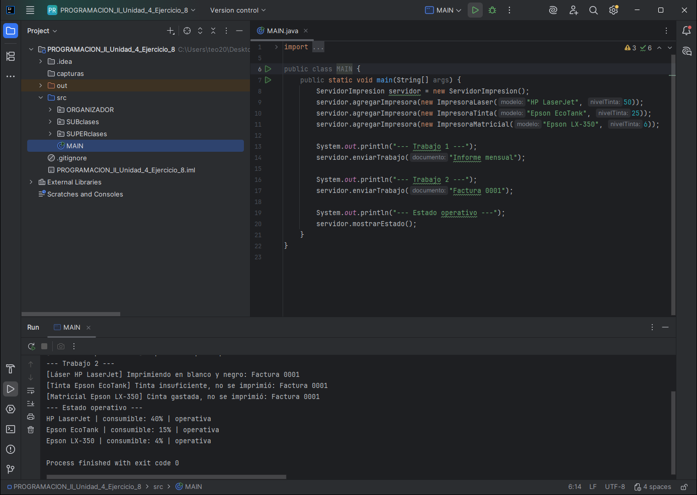

# PROGRAMACIÓN II — Unidad 4, Ejercicio 8: El Sistema de Impresión y Periféricos de Red

Trabajo práctico de Programación II. Este repositorio contiene la resolución en Java del ejercicio 8 de la Unidad 4.

## Consigna

#### Contexto

En una red corporativa, los equipos envían documentos a imprimir a través de un servidor de cola centralizado. Dicho servidor interactúa de manera polimórfica con las impresoras disponibles (láser monocromáticas, de inyección a color o matriciales), asegurando que el comando de impresión se ejecute correctamente independientemente del hardware destino.

#### Consigna

Modelar una jerarquía de clases en Java que utilice polimorfismo para administrar un conjunto heterogéneo de impresoras conectadas a un servidor de red.

#### Desarrollo requerido

- Definir una clase abstracta Impresora con atributos comunes como modelo y nivelTinta, junto al método abstracto imprimirDocumento(String documento).
- Implementar clases concretas como ImpresoraLaser, ImpresoraTinta y ImpresoraMatricial con sus respectivas validaciones de consumibles.
- Desarrollar la clase ServidorImpresion que administre una lista de dispositivos y permita enviar trabajos de forma polimórfica.
- En el método main, instanciar impresoras de diferentes tecnologías, agregarlas al servidor, enviar trabajos de impresión y mostrar el estado operativo por consola.

## Estructura del repositorio

```
PROGRAMACION_II_Unidad_4_Ejercicio_8/
├── README.md
├── capturas/
│   └── consola.png
└── src/
    ├── ORGANIZADOR/
    │   └── ServidorImpresion.java
    ├── SUBclases/
    │   ├── ImpresoraLaser.java
    │   ├── ImpresoraMatricial.java
    │   └── ImpresoraTinta.java
    ├── SUPERclases/
    │   └── Impresora.java
    └── MAIN.java   # clase con el método main
```

## Funcionamiento y lógica

El ejercicio aplica **polimorfismo** en un servidor de impresión que envía cada trabajo a varias impresoras distintas. Está organizado en los paquetes `SUPERclases`, `SUBclases` y `ORGANIZADOR`.

### `SUPERclases.Impresora` (clase abstracta)

Tiene `modelo` y `nivelTinta` (privados, con getters), el método `protected` `consumirTinta()` y el método abstracto `imprimirDocumento(String)`.

### `SUBclases`

Cada impresora controla si tiene consumible suficiente antes de imprimir, y gasta una cantidad distinta:

| Impresora | Nivel mínimo para imprimir | Consumo por trabajo | Tipo de impresión |
|---|---|---|---|
| `ImpresoraLaser` | 10 % | 5 % | blanco y negro |
| `ImpresoraTinta` | 20 % | 10 % | color |
| `ImpresoraMatricial` | 5 % | 2 % | por impacto |

Si no alcanza el consumible, avisan que el documento no se imprimió.

### `ORGANIZADOR.ServidorImpresion`

Guarda una lista de impresoras.

- **`enviarTrabajo(documento)`:** manda el documento a todas.
- **`mostrarEstado()`:** muestra el nivel de consumible de cada una e indica si está operativa o sin consumibles.

### `MAIN`

Arranca con la HP LaserJet al 50 %, la Epson EcoTank al 25 % y la Epson LX-350 al 6 %, y envía dos trabajos:

1. "Informe mensual" → las tres imprimen.
2. "Factura 0001" → solo imprime la láser; la de tinta y la matricial ya no tienen consumible suficiente.

El estado final es **40 %**, **15 %** y **4 %**, y las tres siguen operativas porque les queda algo de consumible.

## Ejecución

Captura de la consola de IntelliJ IDEA ejecutando el programa:



Salida obtenida:

```
--- Trabajo 1 ---
[Láser HP LaserJet] Imprimiendo en blanco y negro: Informe mensual
[Tinta Epson EcoTank] Imprimiendo a color: Informe mensual
[Matricial Epson LX-350] Imprimiendo por impacto: Informe mensual
--- Trabajo 2 ---
[Láser HP LaserJet] Imprimiendo en blanco y negro: Factura 0001
[Tinta Epson EcoTank] Tinta insuficiente, no se imprimió: Factura 0001
[Matricial Epson LX-350] Cinta gastada, no se imprimió: Factura 0001
--- Estado operativo ---
HP LaserJet | consumible: 40% | operativa
Epson EcoTank | consumible: 15% | operativa
Epson LX-350 | consumible: 4% | operativa
```
